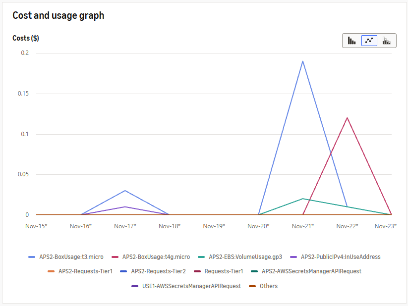

# terraform-finops-spike

A small Terraform project on AWS that builds FinOps (cloud cost management) practices into the infrastructure code: budgets, anomaly detection, cost allocation tags, cost-aware modules, remote state, and cost estimates on pull requests with Infracost.

It started from HashiCorp's "Get Started - AWS" tutorial and grew from there. See [docs/DECISIONS.md](docs/DECISIONS.md) for the problems I hit and the reasoning behind each design choice.

**Status (23 Nov 2026):** the spike is finished. The main project (EC2 and S3) has been destroyed. The guardrails (free) and the state bucket (a few cents a month) are kept. Running `terraform apply` in the root rebuilds the main project.

## What it builds

The project is split into three Terraform roots. Each has its own state, so they can be created and destroyed separately.

| Root | Creates | State stored in |
|---|---|---|
| `guardrails/` | A $15/month AWS Budget (measured before credits) and a Cost Anomaly Detection monitor with daily email alerts | Local file |
| `bootstrap/` | The S3 bucket that holds Terraform state for the main project | Local file |
| `.` (main) | An S3 bucket and one EC2 instance, built from two local modules | S3 bucket created by `bootstrap/` |

All resources are in `ap-southeast-2` (Sydney) and carry the same tags through the AWS provider's `default_tags`: `Owner`, `CostCentre`, `Environment` and `Project`.

## Layout

```
.
├── guardrails/            # budget and anomaly detection
├── bootstrap/             # state bucket for the main project
├── modules/
│   ├── storage/           # S3 bucket: encryption, versioning, lifecycle rule
│   └── compute/           # EC2 instance: gp3 root volume, no public IP
├── main.tf                # calls the storage and compute modules
├── variables.tf
├── outputs.tf
├── terraform.tf           # provider, default_tags, S3 backend
├── docs/DECISIONS.md      # incidents and design decisions
└── .github/workflows/     # Infracost on pull requests and on main
```

## FinOps practices in this project

- **Budget before credits:** the budget ignores promotional credits, so it shows real usage instead of $0.
- **Anomaly detection:** flags unusual spend per AWS service, not just a fixed limit.
- **Cost allocation tags:** every resource is tagged automatically, and the tags are activated in Billing so costs can be grouped by them.
- **S3 lifecycle rule:** old object versions are deleted after 30 days, objects move to Infrequent Access after 30 days, and failed uploads are cleaned up after 7 days.
- **Instance type allow-list:** the compute module only accepts `t3.micro`, `t3.small`, `t4g.micro` and `t4g.small`.
- **No public IP:** avoids the $0.005/hour public IPv4 charge.
- **No leftover disks:** the root volume is deleted with the instance.
- **Rightsizing:** moved from `t3.micro` to Graviton `t4g.micro`, checked with Infracost before applying (about 20% cheaper).
- **Cost estimates on pull requests:** Infracost comments on each PR with the monthly cost change.

## Requirements

- Terraform 1.10 or later (needed for S3 state locking with `use_lockfile`)
- AWS CLI with credentials for an IAM user or SSO profile, not the root account
- Optional: [Infracost CLI](https://www.infracost.io/) for local cost estimates

## Setup

Run each root in this order.

### 1. Guardrails

```sh
cd guardrails
cp terraform.tfvars.example terraform.tfvars   # then add your email address
terraform init
terraform apply
```

`terraform.tfvars` is ignored by git, so the email address stays out of the repo.

### 2. Bootstrap

```sh
cd bootstrap
terraform init
terraform apply
```

This creates a state bucket named `finops-spike-tfstate-<account-id>`.

### 3. Main project

The `backend "s3"` block in `terraform.tf` contains the state bucket name. Terraform does not allow variables there, so if you use a different AWS account, update the bucket name to match the one `bootstrap/` created.

```sh
terraform init
terraform plan
terraform apply
```

## Variables

### Main project

| Name | Default | Description |
|---|---|---|
| `instance_type` | `t4g.micro` | EC2 instance type (must be on the allow-list) |
| `instance_name` | `terraform-spike` | Value of the instance's `Name` tag |

The compute module also has `root_volume_size_gb` (default 8, allowed 8 to 20), `associate_public_ip` (default `false`) and `availability_zone` (default `ap-southeast-2a`).

### Guardrails

| Name | Default | Description |
|---|---|---|
| `alert_email` | none (set in `terraform.tfvars`) | Email address for budget and anomaly alerts |
| `monthly_budget_usd` | `15` | Monthly budget in USD |

## Outputs

| Root | Output | Description |
|---|---|---|
| Main | `bucket_name` | Name of the S3 data bucket |
| Main | `instance_id` | ID of the EC2 instance |
| Bootstrap | `state_bucket_name` | Name of the state bucket |

## Cost

### Estimate (Infracost)

| Resource | Monthly |
|---|---|
| EC2 `t4g.micro` (730 hours) | about $7.74 |
| 8 GB gp3 root volume | about $0.77 |
| S3 buckets | depends on usage, close to $0 here |
| **Total** | **about $8.50** |

The budget and anomaly monitor are free.

### What it actually cost

From Cost Explorer, 17 to 23 Nov 2026, unblended cost with credits excluded:

| Usage type | Cost | What it is |
|---|---|---|
| `APS2-BoxUsage:t3.micro` | $0.230 | x86 instance, before rightsizing |
| `APS2-BoxUsage:t4g.micro` | $0.117 | Graviton instance, after rightsizing |
| `APS2-EBS:VolumeUsage.gp3` | $0.037 | Root volumes |
| `APS2-PublicIPv4:InUseAddress` | $0.012 | Public IP addresses (see incident I2) |
| `Requests-Tier1` / `Tier2` | about $0.0005 | S3 requests, including state file reads and writes |
| **Total** | **about $0.40** | |

Amount actually paid: **$0**, because promotional credits covered all of it. The last day's data was still arriving when these figures were taken, so the final total may be slightly higher.



The graph shows the rightsizing on 22 Nov, where `t3.micro` drops and `t4g.micro` takes over. It also shows a public IPv4 charge on 17 Nov from the original tutorial instance.

### Estimate vs. actual

Infracost got the hourly prices right, but it cannot know:

- **How long things run.** It assumes 730 hours a month; the spike ran for a few days.
- **What happens at runtime.** Public IPv4 addresses, data transfer and S3 requests depend on behaviour, not code.
- **Mistakes.** The public IP from incident I2 was never in the code's intent, so no estimate would include it.
- **Reporting delay.** Cost Explorer data lags by up to a day, so recent days look lower than they are.

Estimates are best for comparing changes before they ship. Actual spend is needed to see what really happened.

## Infracost

Run locally from the project root:

```sh
infracost scan            # cost breakdown and policy checks
infracost diff            # cost change compared with the last scan
```

Two GitHub Actions workflows were generated with `infracost ci setup --pipeline`:

| Workflow | Runs on | What it does |
|---|---|---|
| `infracost-diff.yml` | Pull requests | Compares the PR with the base branch and comments the cost change on the PR |
| `infracost-scan.yml` | Pushes to `main` | Scans the main branch |

Both need an Infracost API key stored as the GitHub secret `INFRACOST_API_KEY`.

**Known issue:** Infracost 2.20 hangs on any project that contains a `terraform.tfvars` file (here, `guardrails/`). Locally, move the file out of the repo while scanning. In CI this does not happen, because the file is not committed.

## What I learned

- **State** maps the code to real AWS resources. Lose it and Terraform creates duplicates and leaves orphans that keep billing.
- **Locking** stops two runs from changing the same state at once. S3 can now do this natively (`use_lockfile`); teams used DynamoDB for it before 2024.
- **Modules** package resources with their settings built in, so cost and security rules are written once and reused.
- **`default_tags` and cost allocation tags:** tagging every resource is easy with `default_tags`, but costs are only grouped by tag after the tags are activated in Billing, and only from that point on. In an AWS Organization, only the management account can activate them.
- **Budgets as code:** budgets and alerts live in version control and are reviewed like any other change.
- **Credits vs. real cost:** credits made every report show $0. Measuring cost before credits is the only way to see real usage.
- **Anomaly detection** watches for unusual patterns per service, which a fixed budget cannot do. It needs about 10 days of history first.
- **Shift-left cost estimation:** Infracost shows the cost of a change before it is applied, and in CI it comments the cost change on each pull request.

## Teardown

```sh
terraform destroy                 # main project
cd guardrails && terraform destroy   # optional: budget and anomaly monitor are free to keep
```

The state bucket is protected by `prevent_destroy` and versioning. To remove it, first destroy the main project, then remove `prevent_destroy` from `bootstrap/main.tf`, empty the bucket (including old versions), and run `terraform destroy` in `bootstrap/`.
